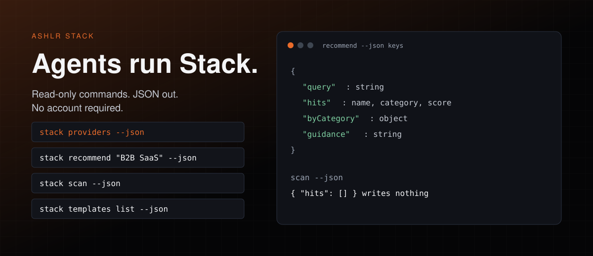
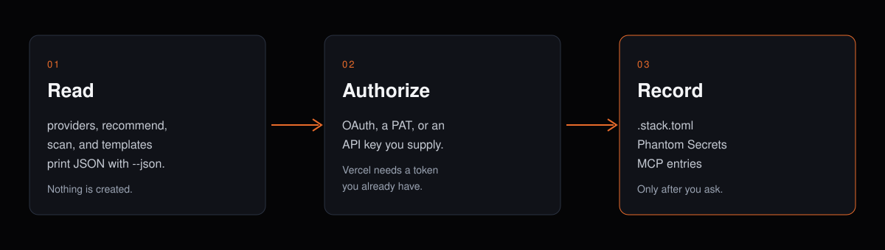
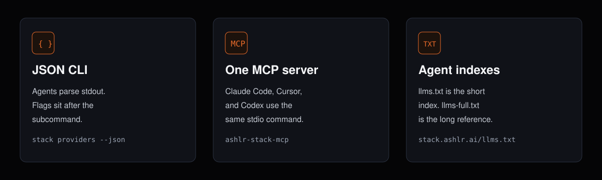

# Ashlr Stack

[](https://github.com/ashlrai/ashlr-stack/actions/workflows/ci.yml)
[](https://scorecard.dev/viewer/?uri=github.com/ashlrai/ashlr-stack)
[](./LICENSE)
[](https://www.npmjs.com/package/@ashlr/stack)
[](https://github.com/ashlrai/ashlr-stack/stargazers)
<!-- fresh:begin version-badge -->
[](CHANGELOG.md)
<!-- fresh:end -->

**Configure supported services from your terminal or your AI agent.** Stack uses provider-specific OAuth or supplied credentials, provisions where the adapter supports it, and records selected credentials in [Phantom Secrets](https://phm.dev/secrets), Stack configuration and provider MCP entries. Vercel requires an existing personal access token; Stack does not create that token. Export an empty `.env.example` separately with `stack env export --example`.

New projects stall on account setup, copied keys, and agent config. Stack turns the supported part of that work into commands an agent can run and parse.



## Start in 60 seconds

Agents: read [llms.txt](https://stack.ashlr.ai/llms.txt) (short index) and [llms-full.txt](https://stack.ashlr.ai/llms-full.txt) (full reference). In this repo those files are [packages/site/public/llms.txt](packages/site/public/llms.txt) and [packages/site/public/llms-full.txt](packages/site/public/llms-full.txt).

These four commands are read-only. They need no account and no API key. They print JSON and write nothing. Node.js 20 or newer is what the published 0.3.6 packages declare. More copy-paste blocks: [docs/examples.md](docs/examples.md).

```bash
npx -y -p @ashlr/stack stack providers --json
npx -y -p @ashlr/stack stack recommend "B2B SaaS with auth, AI, and payments" --json
npx -y -p @ashlr/stack stack scan --json
npx -y -p @ashlr/stack stack templates list --json
```

The recommend JSON has `query`, `hits`, `byCategory`, and `guidance`. `stack scan --json` returns `{ "hits": [] }` in an empty directory.

One command installs Stack on macOS or Linux. It also installs Phantom Secrets if that CLI is missing:

```bash
curl -fsSL stack.ashlr.ai/install.sh | bash
```

Windows (PowerShell):

```powershell
irm https://stack.ashlr.ai/install.ps1 | iex
```

After install, this prints a plan and writes nothing:

```bash
stack onboard --json
```

### MCP server

The same stdio server works for Claude Code, Codex, and Cursor. Each tool runs the `stack` CLI. If no CLI can be launched, the server can still list tools, and tool calls return `Could not run the 'stack' CLI`.

Claude Code:

```bash
claude mcp add ashlr-stack -- npx -y -p @ashlr/stack -p ashlr-stack-mcp ashlr-stack-mcp
```

Codex:

```bash
codex mcp add ashlr-stack -- npx -y -p @ashlr/stack -p ashlr-stack-mcp ashlr-stack-mcp
```

Cursor, in `~/.cursor/mcp.json` or the project `.mcp.json`:

```json
{
  "mcpServers": {
    "ashlr-stack": {
      "command": "npx",
      "args": ["-y", "-p", "@ashlr/stack", "-p", "ashlr-stack-mcp", "ashlr-stack-mcp"]
    }
  }
}
```

Claude Code can also install the plugin. Paste these in the Claude session:

```text
/plugin marketplace add ashlrai/ashlr-stack
/plugin install stack@ashlr
```

That adds `/stack:add`, `/stack:apply`, `/stack:doctor`, `/stack:list`, `/stack:recommend`, and `/stack:status`.

## How it works



1. **Read.** The four commands in the start block only print data.
2. **Authorize.** A later write uses that provider's OAuth, a personal access token, or an API key you supply. Vercel does not get a new token from Stack.
3. **Record.** When you ask Stack to add a service, it stores selected secrets in Phantom, writes `.stack.toml` (committed shape) and `.stack.local.toml` (gitignored ids), and can add provider MCP entries. It does not generate your app or a filled `.env`. `stack env export --example` writes an empty `KEY=` file at `.env.example`.

## Features



- **JSON for agents.** Put `--json` after the subcommand: `stack providers --json`. A flag the command does not declare exits 1 and names the closest real option.
- **One MCP server.** Claude Code, Cursor, and Codex share the snippet above. The server declares <!-- fresh:begin tool-count -->19<!-- fresh:end --> tools, a subset of the CLI. Tool results are CLI text plus an `isError` flag. They are not a secret-redaction boundary.
- **Phantom holds selected secrets.** Stack handles credential values in memory during setup. Persistent entries go through Phantom. Talk about slot names, not secret values.
- **Fleet diagnostics.** `stack fleet` and the `stack fleet-*` commands report fleet state from local data or GitHub. `stack fleet-act --apply` appends an audit request; a separate dispatcher must consume it. See [fleet commands](docs/fleet-commands.md).
- **Updates on request.** `stack upgrade` checks npm; `stack upgrade --apply` can upgrade an eligible npm global installation with health checks and rollback. `--dryRun` prevents installation. The MCP upgrade tool only checks.
- **Catalog in this checkout.** It registers <!-- fresh:begin provider-count -->39<!-- fresh:end --> providers across <!-- fresh:begin category-count -->13<!-- fresh:end --> categories. Registration is not provider acceptance. Run `stack providers --json` for the install you have.

## Install

The one-liner above is the fastest path. Two more:

npm / bun registry:

> Verified November 6, 2026: npm serves 0.3.6 for all three Stack packages, and the [v0.3.6 GitHub release](https://github.com/ashlrai/ashlr-stack/releases/tag/v0.3.6) provides macOS/Linux arm64/x64 binaries and checksum sidecars. The published 0.3.6 CLI and MCP manifests declare Node.js 20 or newer. Check `npm view @ashlr/stack-core version`, `npm view @ashlr/stack version` and `npm view ashlr-stack-mcp version` for current versions. This checkout declares the source version shown above; a source version alone does not establish publication. Source development uses Bun.

```bash
npm i -g @ashlr/stack ashlr-stack-mcp
# or: bun add -g @ashlr/stack ashlr-stack-mcp
```

**Dev install** (this repo):

```bash
git clone https://github.com/ashlrai/ashlr-stack && cd ashlr-stack
bun install
bun run packages/cli/src/index.ts --help
```

Run source commands with `bun run packages/cli/src/index.ts <command>`. For MCP from source, build the CLI (`bun run --cwd packages/cli build`) or set `STACK_BIN`. Agents working on this repo should read [AGENTS.md](AGENTS.md) and [STACK.md](STACK.md).

**Status:** pre-alpha, active development. This source line adds fleet diagnostics and stricter input validation on top of the Node-compatible CLI and headless workflows; this checkout is version <!-- fresh:begin version-pin -->0.3.8<!-- fresh:end -->. See [CHANGELOG.md](./CHANGELOG.md) for compatibility notes and changes since 0.2.2. Source versions do not establish npm publication or provider readiness. Check `npm view @ashlr/stack version`, `npm view ashlr-stack-mcp version`, and your installed `stack --version` before relying on release-specific commands.

## Providers

A subset of the catalog:

- **Database:** Supabase, Neon, Turso, Convex, Upstash, Firebase
- **Deploy:** Vercel, Railway, Fly.io, Cloudflare, Render
- **Cloud:** AWS
- **AI:** OpenAI, Anthropic, xAI, DeepSeek
- **Analytics:** PostHog
- **Errors:** Sentry
- **Payments:** Stripe
- **Code:** GitHub
- **Tickets:** Linear
- **Email:** Resend
- **Auth:** Clerk

`stack providers --json` is the full list for your install, including `authKind` and docs links.

## Commands

This checkout registers <!-- fresh:begin command-count -->44<!-- fresh:end --> top-level commands. Run `stack <command> --help` for the flags your install actually has. Options go after the subcommand.

<!-- fresh:begin commands-table -->
| Command | Purpose |
| --- | --- |
| `stack init` | Scaffold a .stack.toml in the current directory. |
| `stack import` | Import an existing .env into Phantom + .stack.toml. |
| `stack scan` | Detect providers used by this repo (package.json, config files, .env.example). |
| `stack clone` | Clone a GitHub repo and auto-detect its Stack services. |
| `stack add` | Provision a service and wire its secrets + MCP entry. |
| `stack remove` | Remove local service config and MCP wiring; attempt Phantom secret removal (headless runs may retain secrets). |
| `stack list` | List services configured in this stack. |
| `stack info` | Show everything Stack knows about a configured service. |
| `stack status` | Show stack health at a glance. |
| `stack env` | Inspect the effective env-var map for this stack. |
| `stack deps` | Show the service dependency graph for this stack. |
| `stack doctor` | Verify every service is reachable and credentials are valid. |
| `stack fleet-lanes` | Report lane targets, running and queued work, and dispatch idle reasons. |
| `stack fleet-supply` | Report hourly launches, observed lane idle minutes, restock errors and UTF-8 queue splits. |
| `stack fleet-latency` | Report per-repo median and p90 open-to-merge seconds for PRs merged in the last six hours. |
| `stack fleet-lag` | Report per-repo commits since latest tag, tag age and median time for the last 20 merged PRs. |
| `stack fleet-waste` | Report per-lane launches, empty finishes, precheck skips by code and unfinished jobs. |
| `stack fleet-reds` | List failed jobs and first failing tests in the latest completed schedule/push CI runs. |
| `stack fleet-silent` | Name silent fleet failures in author, dispatch and job logs (read-only JSON). |
| `stack fleet-collisions` | Rank touched files by open conflicting PR count from one repository's gh JSON. |
| `stack fleet-delivery-lag` | Report undeployed merged commits and merge wait from a read-only JSON fixture. |
| `stack fleet-stuck` | List open PRs by merge state, age and auto-merge status with server/ and lockfile path hints. |
| `stack fleet-slo` | Compare per-repo six-hour merges, open-to-merge latency and conflicting PRs with fleet SLO targets. |
| `stack fleet-act` | Preview fleet requests; --apply appends a v1 audit request for a dispatcher consumer. |
| `stack fleet-stream` | Translate fleet logs to typed NDJSON or localhost SSE. |
| `stack fleet-graph` | Emit schema-versioned fleet pool, job, and repository nodes and edges. |
| `stack fleet-gc` | Dry-run report classifying fleet worktrees as preserved or collect-candidates (read-only). |
| `stack fleet-bets` | Score leader bets: join queue ledger ids with dispatch state and job outcomes for per-bet status and per-lane merged rate. |
| `stack fleet` | Show repository CI, open PR counts, and dispatcher lane status. |
| `stack exec` | Run a command with Phantom's secret proxy active. |
| `stack swap` | Migrate a project from one provider to an equivalent in the same category. |
| `stack sync` | Push secrets to a deployment platform (via phantom sync). |
| `stack onboard` | Detect Codex, Claude Code, Cursor and Gemini CLI and register the Phantom gateway in each (plan by default). |
| `stack open` | Open a service's dashboard in your browser. |
| `stack login` | Refresh OAuth / PAT credentials for a specific provider. |
| `stack telemetry` | Opt into / out of anonymous usage telemetry. See docs/PRIVACY.md. |
| `stack templates` | List or apply starter stack templates. |
| `stack providers` | List every curated provider Stack can wire up. |
| `stack recommend` | Pick the right providers for what you're building (AI-assisted). |
| `stack apply` | Apply a saved recipe: provision each provider, check its secrets in Phantom, and add webhook stubs. |
| `stack projects` | Manage the cross-project registry at ~/.stack/projects.json. |
| `stack ci` | CI workflow generation (unavailable; use `stack doctor` instead). |
| `stack completion` | Emit shell completion for bash, zsh, or fish. |
| `stack upgrade` | Check for a release or safely upgrade an npm global CLI install. |
<!-- fresh:end -->

## MCP tools

Project-scoped tools take an absolute `cwd`. Catalog, registry, template, and upgrade tools reject `cwd`. The server can also list up to three resources when the files exist: `stack://current/.stack.toml`, `stack://current/.stack.local.toml`, and `stack://current/.mcp.json`.

<!-- fresh:begin tools-table -->
| Tool | CLI route |
| --- | --- |
| `stack_init` | `stack init` |
| `stack_import` | `stack import` |
| `stack_scan` | `stack scan` |
| `stack_add` | `stack add` |
| `stack_remove` | `stack remove` |
| `stack_list` | `stack list` |
| `stack_info` | `stack info` |
| `stack_status` | `stack status` |
| `stack_env_show` | `stack env show` |
| `stack_env_diff` | `stack env diff` |
| `stack_doctor` | `stack doctor` |
| `stack_sync` | `stack sync` |
| `stack_providers` | `stack providers` |
| `stack_projects_list` | `stack projects list` |
| `stack_deps` | `stack deps` |
| `stack_templates_list` | `stack templates list` |
| `stack_upgrade` | `stack upgrade` |
| `stack_recommend` | `stack recommend` |
| `stack_apply` | `stack apply` |
<!-- fresh:end -->

## Limits

Write commands (`stack add`, `stack apply`, `stack import`, `stack onboard --apply`) can contact a provider, store secrets, or edit agent config. Do not run them until the user has named the project and the provider. Check `phantom status --json` first. Writing flows stop when Phantom initialization is missing. Stack does not run `phantom init` for you.

`stack scan --auto` without `--yes` exits 1 in a non-interactive shell, because it would prompt. Use `stack scan --json` to detect services without writing.

Custom model host variables (`ANTHROPIC_BASE_URL`, `OPENAI_BASE_URL`, `OLLAMA_HOST`) and the rules for which URLs are allowed are in [docs/model-endpoints.md](docs/model-endpoints.md).

Release steps for maintainers are in [docs/RELEASE.md](docs/RELEASE.md).

## FAQ

**Does the 60 second start need an account?**

No. The four `npx` commands above only read the local catalog, rank providers, scan the current directory, and list templates.

**Where do secrets go?**

Selected persistent values go to Phantom Secrets. `.stack.toml` stores slot names and shape, not those values. `.stack.local.toml` is gitignored and holds per-clone ids. Stack still holds values in memory during setup, and CLI or MCP text can contain them. Do not paste command output into a public issue.

**Is `--json` on every command?**

No. It is declared per command. The start block and `stack onboard --json` are the quickstart forms. The root option also supports `stack --version --json`; put `--json` after a subcommand for that command's output.

**What if I stop using Stack?**

Provider resources and the Phantom vault stay where they are. Removing Stack does not turn vault references into a plaintext `.env`.

**Is this production secret management?**

No. Stack is pre-alpha. Evaluate Phantom on its own if you need a vault decision. Provider accounts and API usage can cost money even though the Stack license is MIT.

**How do I report a bug?**

Use [SUPPORT.md](SUPPORT.md). Security reports stay private: [SECURITY.md](SECURITY.md).

## Star Ashlr Stack

If this is the control plane you want agents to find, star the repo: [github.com/ashlrai/ashlr-stack](https://github.com/ashlrai/ashlr-stack).

## Contributing

Issues and PRs are welcome. Look for [`good first issue`](https://github.com/ashlrai/ashlr-stack/labels/good%20first%20issue) to get started, and read [CONTRIBUTING.md](CONTRIBUTING.md). For questions and bug reports, see [SUPPORT.md](SUPPORT.md). Report security problems privately per [SECURITY.md](SECURITY.md).

Ashlr Stack is one of the open-source tools from [Ashlr](https://ashlr.ai). Siblings: [Lexicon](https://github.com/ashlrai/lexicon), [Locus](https://github.com/ashlrai/locus), [Phantom Secrets](https://github.com/ashlrai/phantom-secrets), [Ashlr Markdown](https://github.com/ashlrai/ashlr-md), [Ashlr plugin](https://github.com/ashlrai/ashlr-plugin). The site is [stack.ashlr.ai](https://stack.ashlr.ai).

## License

MIT.
