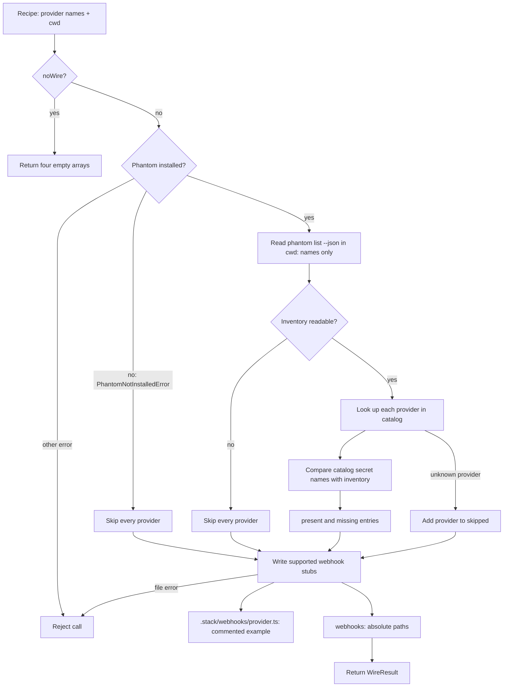

# Phantom wire data flow

[`wirePhantomForRecipe`](../packages/core/src/ai/phantom-wire.ts) compares
catalog secret names with a Phantom inventory and generates webhook examples.
It does not store secret values, provision services, or install handlers.
The diagram follows a direct call; `stack apply` calls it only after at least
one provider succeeds, passing the **whole** recipe, including any providers
whose provisioning failed. Its results do not establish provisioning success.

The diagram groups the per-provider loop for readability: each supported stub
is written even when that provider is skipped, and unknown providers have no
catalog secrets to compare. `cwd` defaults to the current working directory.
`noWire` returns before the installation probe, inventory read, or file writes.
With `stack apply --no-wire`, the CLI still performs its own prerequisite and
provisioning steps before invoking this early return.

## Inventory and result

Only `providers[].name` is consumed from the recipe. The catalog supplies each
known provider's secret names; `phantom list --json` supplies stored names,
not values. For a readable inventory, each catalog name becomes a
`provider:SECRET_NAME` entry in `present` or `missing`. An unknown provider,
an unreadable inventory, or a missing Phantom installation adds the provider
to `skipped` instead. An empty `missing` list therefore does not establish that
all secrets are present; inspect `skipped` too. A present name does not prove
its value is valid or accessible.

For example, with Stripe and GitHub in the recipe, only `STRIPE_SECRET_KEY`
in a readable inventory, and an additional unknown provider `unknown`, the
result includes `stripe:STRIPE_SECRET_KEY` in `present`,
`github:GITHUB_TOKEN` in `missing`, and `unknown` in `skipped`. Stripe and
GitHub also produce stub paths. Entries preserve recipe and catalog order and
are not deduplicated.

## Webhook output and trust boundary

The supported providers are `stripe`, `clerk`, `supabase`, and `github`.
Wiring creates `.stack/webhooks/` as needed and writes an absolute path to
`webhooks` for each generated `<provider>.ts`. It overwrites an existing file;
if a later write fails, earlier files can remain and the call rejects without
returning a result. Other installation errors also propagate; inventory read
errors instead produce `skipped` entries. The CLI catches a rejected wire call
and reports a warning.

**Webhook signature verification is not implemented.** Each generated file
is entirely commented out, including its `TODO(security)` and provider-specific
verification hint. No request is authenticated during wiring. If the example
handler is uncommented as written, it rejects a missing or empty signature
header, reads the body, and returns 200 for any non-empty header without
verifying it. Treat the body as untrusted; implement the provider's signature
verification over the raw body and reject invalid signatures before acting on
it. The stub names a webhook secret but does not retrieve it; that name is not
necessarily one of the catalog secrets inventoried above.

Recipe manifests are also unsigned: catalog name checks do not authenticate
their origin or integrity. Use trusted recipes. See the
[boundary review](phantom-wire-boundary.md) for error details and the
[signature review](phantom-wire-signature-review.md) for provider-specific hints.
