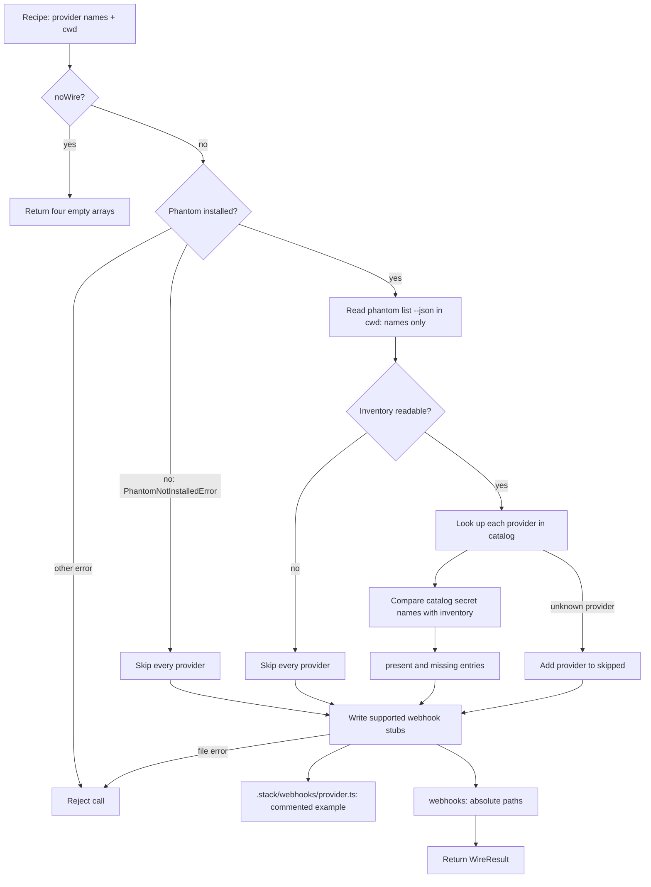

# Phantom wire data flow

[`wirePhantomForRecipe`](../packages/core/src/ai/phantom-wire.ts#L48) compares
catalog secret names with a Phantom inventory and generates webhook examples.
It does not store secret values, provision services, or install handlers.
Wiring assumes a trusted recipe and a readable Phantom secret-name inventory;
neither assumption establishes authenticity. The diagram follows a direct
call; `stack apply` calls it only after at least one provider succeeds,
passing the **whole** recipe, including any providers whose provisioning
failed. Its results do not establish provisioning success.

The diagram groups the per-provider loop for readability: each supported stub
is written even when that provider is skipped, and unknown providers have no
catalog secrets to compare. `cwd` defaults to the current working directory.
`noWire` returns before the installation probe, inventory read, or file writes.
With `stack apply --noWire`, the CLI still performs its own prerequisite and
provisioning steps before invoking this early return.

## Inventory and result

Only `providers[].name` is consumed from the recipe. The catalog supplies each
known provider's secret names; `phantom list --json` supplies stored names,
not values (see [`listSecrets`](../packages/core/src/phantom.ts#L271)). For a
readable inventory, each catalog name becomes a `provider:SECRET_NAME` entry
in `present` or `missing`. An unknown provider, an unreadable inventory, or a
missing Phantom installation adds the provider to `skipped` instead; `skipped`
does not mean the secret is missing. An empty `missing` list therefore does
not establish that all secrets are present; inspect `skipped` too. A present
name is only evidence that the name appeared in the inventory, not that its
value is valid or usable. See
[`WireResult` and the branching logic](../packages/core/src/ai/phantom-wire.ts#L31).

For example, with Stripe and GitHub in the recipe, only `STRIPE_SECRET_KEY`
in a readable inventory, and an additional unknown provider `unknown`, the
result includes `stripe:STRIPE_SECRET_KEY` in `present`,
`github:GITHUB_TOKEN` in `missing`, and `unknown` in `skipped`. Stripe and
GitHub also produce stub paths. Entries preserve recipe and catalog order and
are not deduplicated.

## Webhook output

Wiring writes fully commented examples to `.stack/webhooks/<provider>.ts` for
the providers below, even when inventory checks are skipped. It creates
`.stack/webhooks/` as needed and writes an absolute path to `webhooks` for
each generated file. It **overwrites existing files** at those paths; if a
later write fails, earlier files can remain and the call rejects without
returning a result. Other installation errors also propagate; inventory read
errors instead produce `skipped` entries. See
[`writeWebhookStub`](../packages/core/src/ai/phantom-wire.ts#L111).

| Provider | Header in example | Secret named in example |
| --- | --- | --- |
| stripe | `stripe-signature` | `STRIPE_WEBHOOK_SECRET` |
| clerk | `svix-signature` | `CLERK_WEBHOOK_SECRET` |
| supabase | `x-supabase-signature` | `SUPABASE_WEBHOOK_SECRET` |
| github | `x-hub-signature-256` | `GITHUB_WEBHOOK_SECRET` |

The stub names a webhook secret but does not retrieve it; that name is a hint,
not necessarily one of the catalog secrets inventoried above.
[`stack apply`](../packages/cli/src/commands/apply.ts#L131) catches a rejected
wire call and reports a warning. A stub or an apply result does not prove that
a provider was provisioned or an endpoint registered.

## Signature-verification TODO and trust limits

**Webhook signature verification is not implemented.** The
[`webhookStubFor` TODO](../packages/core/src/ai/phantom-wire.ts#L118) is
commented guidance for a future handler, not implemented verification. Each
generated file is entirely commented out, including its `TODO(security)`,
the secret retrieval and the provider-specific verification hint. No request
is authenticated during wiring. If the example handler is uncommented as
written, it rejects a missing or empty signature header,
reads the body, and returns 200 for any non-empty header without verifying it.
Because it accepts any non-empty header, neither sender nor body is
authenticated.

Before deploying a handler, treat the body as untrusted and implement the
provider's current documented verification for its webhook product, including
the exact raw body, required headers, secret and any replay protection; reject
invalid requests before trusting or acting on the body. Prefer the provider's
verification library and use constant-time comparison when implementing a MAC
comparison directly.

Recipe manifests are also unsigned, a separate limitation from the webhook
TODO. [`readRecipe`](../packages/core/src/ai/recipe.ts#L105) checks provider
names against the catalog, but that does not authenticate the recipe's origin
or integrity. Review recipes and use a trusted source before applying them.
See the [boundary review](phantom-wire-boundary.md) for error details and the
[signature review](phantom-wire-signature-review.md) for provider-specific hints.
